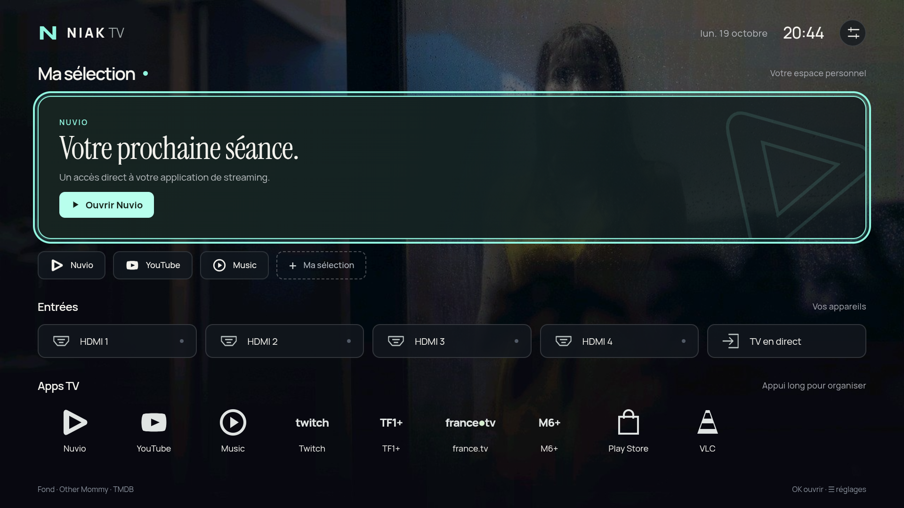

  
  
<a href="README.md">English</a> · <strong>Français</strong>

  <h3>Moins de bruit. Plus de place pour votre TV.</h3>
  
Votre prochaine séance, vos apps favorites et vos appareils connectés. Un accueil Android TV personnel, de l’ambiance cinéma à l’essentiel.

  
<kbd>Android TV 8+</kbd> <kbd>Sans publicité</kbd> <kbd>Sans télémétrie</kbd> <kbd>EN / FR</kbd>

  

<a href="#experience"><strong>Expérience</strong></a> · <a href="#install"><strong>Installer</strong></a> · <a href="#customise"><strong>Personnaliser</strong></a> · <a href="#documentation"><strong>Documentation</strong></a>

  
   Capture de NiakTV sur Android TV, avec une sélection d’apps neutre et un flux de reprises vide. Aucun historique de visionnage personnel n’est affiché.

---

## ✨ Une place pour ce que vous utilisez vraiment

**Ma sélection → Entrées → Apps TV.** Une interface pensée pour la télécommande, des pictogrammes dédiés, un focus visible et une typographie qui laisse respirer les contenus.

| À votre façon                | Ce que vous retrouvez                                                                                                                                                                                                         |
| ---------------------------- | ----------------------------------------------------------------------------------------------------------------------------------------------------------------------------------------------------------------------------- |
| **Un peu de cinéma**         | Des fonds TMDB quotidiens issus du catalogue des films à l’affiche. Le titre original du film reste discrètement crédité en bas à gauche.                                                                                     |
| **Votre prochaine séance**   | Les vraies reprises Nuvio, leurs illustrations et leur progression lorsqu’elles sont publiées par l’app. Nuvio est facultatif : une app de streaming compatible déjà installée peut prendre sa place sous forme de raccourci. |
| **Vos propres raccourcis**   | Choisissez vos favoris et réorganisez le dock par un appui long sur OK. Les entrées HDMI restent à portée de main.                                                                                                            |
| **La liberté de simplifier** | Masquez Ma sélection, choisissez un fond uni ou un dégradé statique, puis une palette Menthe, Violet, Bleu ou Graphite.                                                                                                       |
| **Un accueil plus léger**    | Le mode performance masque Ma sélection, utilise un fond uni et coupe le chargement des programmes et des images de contenu. Le focus télécommande reste visible.                                                             |
| **Votre langue**             | Français, anglais ou langue du téléviseur. Les noms d’apps et de programmes gardent leurs libellés d’origine.                                                                                                                 |

Aucune ligne sponsorisée, bande-annonce automatique ou analyse d’usage. L’interface et les polices sont stockées sur la TV. Les fonctions principales du lanceur ne nécessitent ni Nuvio ni compte TMDB.

## ⚡ Prendre ses marques

NiakTV est actuellement distribué sous forme d’**APK de développement** dans [GitHub Actions](https://github.com/niakw/NiakTV/actions/workflows/android.yml).

1. Ouvrez une compilation réussie, téléchargez **niaktv-debug** et extrayez `app-debug.apk`.
2. Activez le débogage ADB sur la TV, connectez-vous depuis l’ordinateur et installez l’APK.
3. Ouvrez NiakTV, puis **Réglages → Bouton Accueil** pour configurer le comportement permis par votre TV.

**[Guide d’installation →](INSTALL.fr.md)** Commandes, premier démarrage, mises à jour, dépannage et retour à l’accueil d’origine.

NiakTV conserve l’accès au lanceur d’origine. Le service Accueil facultatif assure la compatibilité avec certaines TV qui imposent Google ; il ne lit pas le contenu des fenêtres. Aucun composant système ne doit être supprimé ou désactivé.

## 🎛 Cinéma quand vous voulez. Minimal quand vous préférez.

| Votre point de départ | Dans les réglages                                                                                                                                                            |
| --------------------- | ---------------------------------------------------------------------------------------------------------------------------------------------------------------------------- |
| **Cinéma**            | Style du fond → Cinéma, puis configurez votre propre clé TMDB. Choisissez le changement quotidien ou gardez un fond favori.                                                  |
| **Minimal**           | Activez le mode performance pour garder entrées et apps sur un fond uni. Le désactiver rétablit vos choix précédents de sélection et de fond.                                |
| **Entre les deux**    | Masquez Ma sélection indépendamment, choisissez un dégradé et votre palette. Changer le style du fond ou la visibilité du bloc désactive le mode performance.                |
| **Reprises**          | Avec Nuvio installé, autorisez l’accès aux programmes Android TV. Seuls les titres réellement publiés par Nuvio apparaissent ; leur ouverture suit le lien fourni par l’app. |

Sans Nuvio, NiakTV peut proposer un raccourci vers une app de streaming compatible déjà installée. Sans app compatible, aucune carte de remplacement. Le lanceur n’invente pas d’historique de lecture pour les autres services.

TMDB utilise votre clé API ou votre jeton de lecture personnel, conservé dans le stockage privé de la TV et exclu des sauvegardes. Cet identifiant n’est jamais intégré à l’APK ni transmis à l’interface JavaScript. Les fonds unis et dégradés ne téléchargent aucune image de cinéma.

## 📚 Trouver son chemin

| Vous souhaitez…                                          | Consultez                                       |
| -------------------------------------------------------- | ----------------------------------------------- |
| Installer, mettre à jour ou rétablir l’accueil d’origine | [Installation](INSTALL.fr.md)                   |
| Compiler l’app ou contribuer                             | [Contribution](CONTRIBUTING.md#francais)        |
| Comprendre les vérifications et les limites connues      | [Validation](VALIDATION.md#francais)            |
| Comprendre la navigation et les limites d’accessibilité  | [Accessibilité](ACCESSIBILITY.md#francais)      |
| Signaler une vulnérabilité en privé                      | [Sécurité](SECURITY.md#francais)                |
| Participer à la communauté                               | [Code de conduite](CODE_OF_CONDUCT.md#francais) |

Les questions vont dans [Discussions](https://github.com/niakw/NiakTV/discussions) ; les anomalies reproductibles et suggestions dans les [Issues](https://github.com/niakw/NiakTV/issues/new/choose). Le français et l’anglais sont les bienvenus.

## Crédits et licence

[GNU GPL v3](LICENSE). Les polices Manrope et Instrument Serif conservent leurs [notices SIL Open Font License](app/src/main/assets/fonts/). Le fond de secours original a été créé pour NiakTV. Les visuels de films restent la propriété de leurs ayants droit.

Ce produit utilise l’API TMDB sans être approuvé ni certifié par TMDB. NiakTV est indépendant de TMDB, de Nuvio et des marques d’applications représentées dans son interface.
