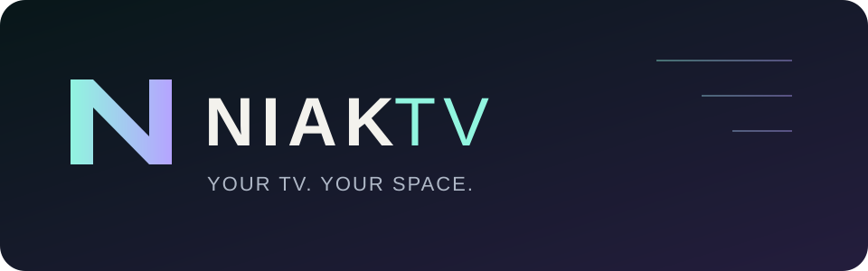
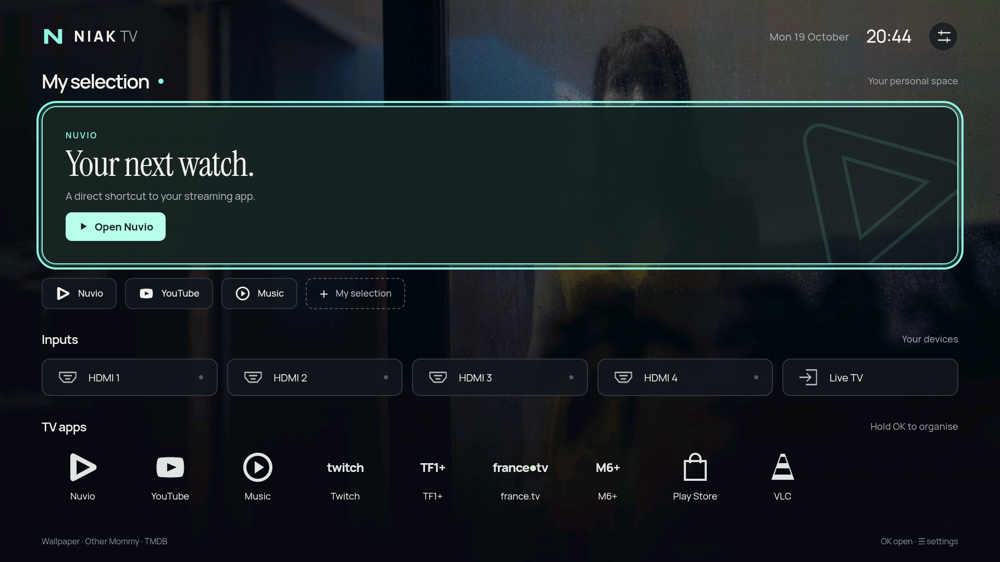

  
  
<strong>English</strong> · <a href="README.fr.md">Français</a>

  <h3>Less noise. More of your TV.</h3>
  
Your next watch, your favourite apps and your connected devices. A personal Android TV home, from cinema atmosphere to just the essentials.

  
<kbd>Android TV 8+</kbd> <kbd>No ads</kbd> <kbd>No telemetry</kbd> <kbd>EN / FR</kbd>

  

<a href="#experience"><strong>Experience</strong></a> · <a href="#install"><strong>Install</strong></a> · <a href="#customise"><strong>Customise</strong></a> · <a href="#documentation"><strong>Documentation</strong></a>

  
   Interface preview with a neutral demo app selection and an empty watch-next feed. No personal viewing history is shown.

---

## ✨ A place for what you actually use

**My selection → Inputs → TV apps.** A remote-first interface with custom app marks, clear focus and typography that gives content room to breathe.

| Make it yours              | What you get                                                                                                                                                           |
| -------------------------- | ---------------------------------------------------------------------------------------------------------------------------------------------------------------------- |
| **A little cinema**        | Daily TMDB backdrops from the now-playing catalogue. The film’s original title and release date stay discreetly credited at the bottom left.                                           |
| **Your next watch**        | Real Nuvio watch-next titles, artwork and progress when published by the app. Three resume items by default, with a configurable count. Pick another installed app to use its shortcut instead. |
| **Your own shortcuts**     | Reorder your favourites and the app dock independently with a long press on OK. HDMI inputs stay within reach.                                                                     |
| **Room to keep it simple** | Hide My selection, use a solid colour or a static gradient, and choose Mint, Violet, Blue or Graphite.                                                                 |
| **A lighter home**         | Performance mode hides My selection, uses a solid background and stops programme and content-image loading. Sized WebP artwork, compact vector icons and WOFF2 fonts keep the interface light. The remote focus stays visible.                            |
| **Your language**          | English, French or the TV’s language. App and programme names keep their original labels.                                                                              |

No sponsored rows, autoplay trailers or analytics. The interface and fonts are stored on the TV. No Nuvio installation or TMDB account is needed for the launcher’s core features.

## ⚡ Get started

**[Download NiakTV APK](https://github.com/niakw/NiakTV/releases/latest/download/niaktv-0.3.1.apk)** · [Release notes](https://github.com/niakw/NiakTV/releases/latest)

A signed APK is ready to install: no compilation, GitHub Actions account or ZIP extraction required. Version 0.3.1 is an early development build, not a production release.

1. Download `niaktv-0.3.1.apk` using the link above.
2. Transfer it to the TV and open it with a file manager, allowing installation from that source when prompted. Alternatively, use `adb install -r niaktv-0.3.1.apk`.
3. Open NiakTV, then use **Settings → Home button** to configure the Home behaviour supported by your TV.

**[Installation guide →](INSTALL.md)** Includes commands, first setup, updates, troubleshooting and how to return to the original home.

Home setup depends on the TV. NiakTV supports the native Home choice and an optional compatibility relay without reading window content. Some firmwares require an explicit, reversible ADB setup to disable Google home before Android can select NiakTV directly. The app never disables system components itself. See the [Home setup and restore guide](INSTALL.md#advanced-home).

## 🎛 Cinema when you want it. Minimal when you don’t.

| Start here               | In Settings                                                                                                                                           |
| ------------------------ | ----------------------------------------------------------------------------------------------------------------------------------------------------- |
| **Cinema**               | Background style → Cinema, then configure your own TMDB key. Choose daily change or keep a favourite backdrop.                                        |
| **Minimal**              | Enable Performance mode for inputs and apps on a solid background. Turning it off restores the previous selection and background choices.             |
| **Somewhere in between** | Hide My selection independently, choose a gradient and set your palette. Choosing a background or changing section visibility exits Performance mode. |
| **Watch next**           | With Nuvio installed, allow Android TV programme access. Only titles actually published by Nuvio appear; opening one follows Nuvio’s link.            |

Choose **My selection app** to use Automatic or another installed, launchable app, even when Nuvio is present. Without a supported app, no replacement card appears. It does not manufacture watch history for other streaming services.

TMDB uses a personal API key or read access token stored privately on the TV and excluded from backups. The credential is never embedded in the APK or passed to the JavaScript interface. Solid and gradient backgrounds do not download cinema images.

## 📚 Find your way

| You want to…                                              | Read                                  |
| --------------------------------------------------------- | ------------------------------------- |
| Install, update or restore the original home              | [Installation](INSTALL.md)            |
| Build the app or contribute                               | [Contributing](CONTRIBUTING.md)       |
| Understand what has been checked and what remains limited | [Validation](VALIDATION.md)           |
| Understand remote navigation and accessibility limits     | [Accessibility](ACCESSIBILITY.md)     |
| Report a vulnerability privately                          | [Security](SECURITY.md)               |
| Participate in the community                              | [Code of conduct](CODE_OF_CONDUCT.md) |

Questions belong in [Discussions](https://github.com/niakw/NiakTV/discussions); reproducible bugs and feature requests belong in [Issues](https://github.com/niakw/NiakTV/issues/new/choose). English and French are welcome.

Build dependencies are maintained separately from the installed app. See [security and dependency scope](SECURITY.md#english).

## Credits & licence

[GNU GPL v3](LICENSE). Bundled Manrope and Instrument Serif fonts retain their [SIL Open Font License notices](app/src/main/assets/fonts/). The original fallback artwork was created for NiakTV. Film artwork belongs to its respective rights holders.

This product uses the TMDB API but is not endorsed or certified by TMDB. NiakTV is independent of TMDB, Nuvio and the app brands shown in its interface.
